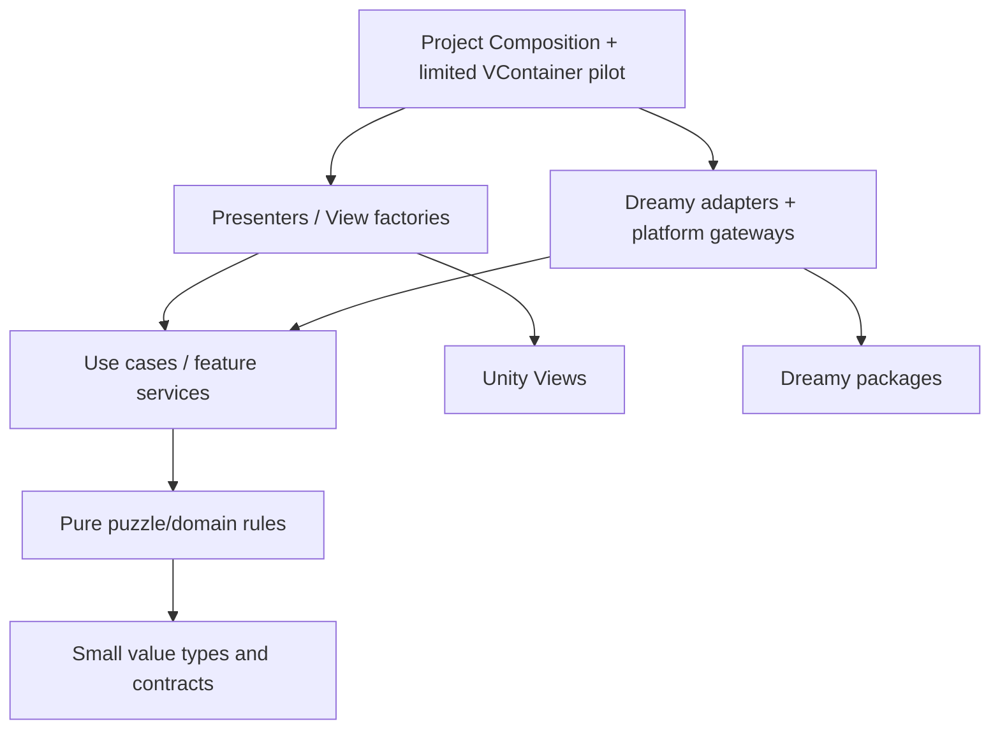

> **SDK decision mới:** SDK ngoài do DreamySDK xử lý; hiện dùng API stub/default theo user để local test. Không cần provider thật cho local UI acceptance. Production/provider gates vẫn riêng. [Contract](11-dreamy-sdk-boundary.md).

> **ADR cập nhật theo user:** không tạo HomeComposition hoặc HomePresenterFactory mới. Home giữ HomeNavigator và constructor DI trực tiếp. VContainer chỉ cài pin ở M00; bài tập scope chuyển sang GAME. Đoạn Home container pilot cũ bên dưới là lịch sử thiết kế đã bị thay thế bởi quyết định này.

# Kiến trúc DI, MVP và ownership

## Dependency direction



Không có Domain→Unity, Domain→VContainer, Domain→Dreamy locator, View→save/wallet/service locator hoặc Dreamy package→BusFever. Một interface xuất hiện vì boundary/test/alternate provider, không tạo I-prefixed twin cho mọi class. Domain phát domain facts; presenter/polish observer quyết định effect, không cho tween/event hồi tiếp thành quyền đổi luật.

## Cấu trúc đích đề xuất, chưa tạo

```text
Assets/_Project/
  Scripts/Bootstrap/                 # GameInstaller hiện hữu, thay đổi có kiểm soát
  Scripts/BusFever/
    Composition/                    # scopes, registrations, ready orchestration
    Domain/                         # board, paths, matching, capacity, rules
    Application/                    # commands, sessions, progression use cases
    Integration/                    # Dreamy, assets, save, clock, platform gateways
    Features/<Feature>/             # Model, Presenter, View contracts, routing
    Presentation/                   # scene views, camera, movement/polish playback
  _Feature/                         # integrations/samples hiện hữu; giữ GUID và owners
  Prefabs/BusFever/<Feature>/        # variants or owned prefabs, binding receipts
  Data/BusFever/                     # imported config/catalog assets
  Art/BusFever/                      # selected source-derived assets, không raw dump
  Tests/BusFever/{Editor,PlayMode}/
  Editor/BusFever/                   # importers/validators; không vào Runtime
```

Các assembly mới dự kiến `BusFever.Domain`, `BusFever.Application`, `BusFever.Presentation`, `BusFever.Integration`, `BusFever.Composition`, Editor/test tương ứng; chỉ tách khi có owner thực, tránh hàng chục asmdef rỗng. Domain `noEngineReferences:true`; only Composition references VContainer. Views có thể cần assembly Unity/UGUI/TMP; application không tham chiếu presentation. T001 chốt namespace và asmdef references từ package names thực tế, không copy sơ đồ thành manifest API chưa verify.

## ADR-01: giữ GameInstaller là owner hạ tầng

GameInstaller tiếp tục tạo/initialize/rollback/dispose các service Dreamy hiện có. Root VContainer mới được build **sau BootstrapState.Ready**, nhận bridge/proxy không sở hữu wallet/datasave/audio/feedback. Không register service IDisposable bên ngoài theo cách khiến container tự Dispose; phải source-review semantics RegisterInstance ở pin và kiểm tra borrowed wrapper/no-op ownership boundary. Khi root bị teardown: child presenter/session scope hủy trước, bridge unregister sau, GameInstaller teardown cuối. Startup fail/cancel không publish root half-ready. Không vừa chạy entrypoint async từ container vừa chạy cùng init từ Awake.

Giải pháp dài hạn chuyển toàn bộ composition sang VContainer là ADR riêng sau khi clone ổn; hiện không đồng thời rewrite framework và clone. Locator chỉ còn ở template/packages/adapters root đã tồn tại. Feature mới constructor injection trực tiếp, chỉ Home factory và gameplay session dùng VContainer; không truyền IObjectResolver vào presenter/domain.

## Scope/lifetime ledger

| Scope | Đối tượng | End / cleanup |
| --- | --- | --- |
| Application | Clock, platform gateways, config readers, save adapter, wallet bridge, navigation policy | App shutdown; owner gốc dispose exactly once |
| Scene/session | Puzzle session, board, passenger simulation, command gate, deterministic random stream, scene presenter | Exit/retry/new level: cancel→stop input→kill owned tween→unsubscribe→release pooled objects/handles→dispose |
| Panel instance | Presenter/binding/subscription/open-request token | Dreamy panel lifecycle/factory dispose; không tạo một singleton presenter giữ view chết |
| Pooled entity | Reused view renderer, motion state, FX handles | On rent reset; on return cancel entity CTS, stop FX, clear callbacks; không mở DI scope mỗi passenger |
| Transaction | Reward/IAP/ad attempt token, immutable snapshot | Resolve once, persist receipt/recovery, late callback ignored by identity |

VContainer scoped IDisposable không tự bảo đảm hủy MonoBehaviour/GameObject không nằm dưới scope. Đặt view/session roots đúng parent hoặc destroy/release explicit. [Lifetime documentation](https://vcontainer.hadashikick.jp/scoping/lifetime-overview). Đăng ký MonoBehaviour theo factory/scope thực tế; không scan cả scene vào container mỗi lần mở popup. [Component registration](https://vcontainer.hadashikick.jp/registering/register-monobehaviour).

## ADR-02: gắn vào Dreamy MVP factory

PanelManager vẫn sở hữu navigation/cache/transition. Factory đã có được dùng để tạo presenter qua typed feature factories được DI cấp dependencies; một owner duy nhất gọi Show/Dispose theo contract UI version thực tế. Không dùng VContainer entrypoint Show thêm một lần cho presenter đã được PanelManager Show. Cached view có thể sống lâu hơn presenter: test reopen20lần, bind exactly once/session, detach mọi handler khi close/dispose. Không global mutable viewmodel dùng chung cho hai panel.

View chỉ có serialized bindings, render immutable view-state, gửi intent. Presenter dùng use case/service, apply projection, khóa nút đúng trạng thái và cancel khi close. Model/domain sở hữu luật/state, không TextMeshPro. Một CTA purchase không trực tiếp cộng tiền; reward service transaction commit rồi View quan sát balance/reward receipt để animate. Balance counter animation không phải tiền thật.

## Luồng gameplay

Tap→input policy/tutorial/modal gate→MoveVehicleCommand→domain validate occupancy/direction/reserved parking→commit logical reservation→motion event→view playback→arrival acknowledgement có request ID→boarding simulation→completion fact→progression/reward transaction→Victory presentation. T014/T015 chốt chính xác thời điểm commit/arrival theo observation; sơ đồ là kiến trúc dự kiến, chưa xác nhận semantics game nguồn. Cancel animation không tự rollback một transaction đã commit; retry creates new session ID.

## State boundaries

Static: level definitions, difficulty, capacity, curves, offers, unlock, localization. Persistent: completed level/progress, wallet, owned booster, setting, profile, life timestamps, event cycle/claim receipts. Session: occupancy, parked slots, moving entities, passenger queue and pending command; không persist bằng Unity instance ID. Mid-level save có/không cần theo runtime nguồn; chưa tự thêm resume semantics.

## Events, async và SOLID

Command là yêu cầu có owner và kết quả, event là sự thật immutable đã xảy ra. Không dùng global event bus thay mọi lời gọi hoặc biến dependency thành ẩn. Một command có correlation/session/transaction ID. Async tác vụ có token theo owner, exception được xử lý ở boundary; `.Forget()` chỉ ở root/event-handler có error policy. View close trong lúc ad/IAP không làm mất transaction receipt. Cancellation không có nghĩa provider chắc chắn dừng; late callback phải dedupe.

SRP qua các owner trên; OCP cho mechanism/rule strategy khi đã có2variant; LSP: mock/provider cùng failure/cancel semantics; ISP: wallet read/change tách khi package hỗ trợ; DIP: application phụ thuộc gateway contract. Không dùng SOLID làm lý do tạo tầng pass-through vô nghĩa.

## ADR-03: giới hạn container, installer theo feature

VContainer chỉ có Home pilot và gameplay session scope; phần còn lại constructor DI trực tiếp. Mỗi Dreamy feature tách installer riêng khi đến lượt feature đó. GameInstaller điều phối readiness/rollback/reverse teardown; installer không tạo lại foundation services. Chi tiết, acceptance và skill routing tại [hợp đồng senior implementation](09-senior-implementation.md). Scope ledger ở trên mô tả lifetime logic, không yêu cầu tạo DI container scope cho mọi dòng.
