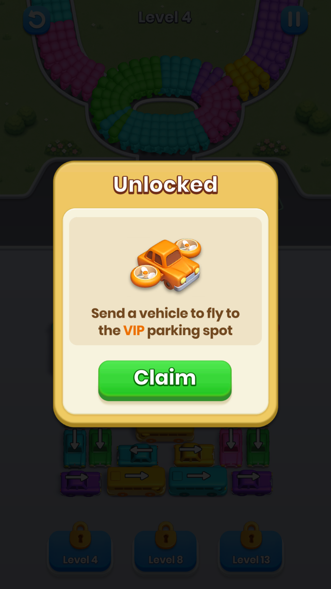
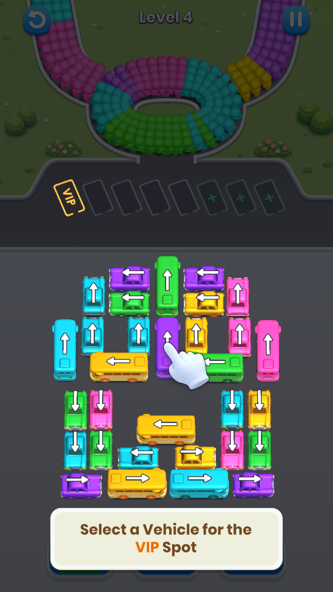
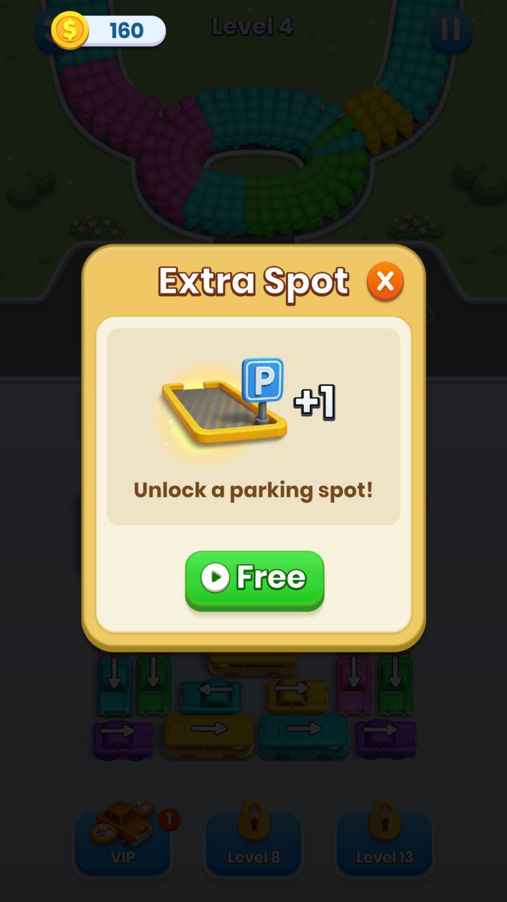

# VIP và Extra Spot

## VIP mở tại Level 4

Đã quan sát popup “Unlocked”, hình xe cam có cánh quạt và nội dung đưa xe bay đến ô VIP. Claim chuyển sang tutorial spotlight tại booster trái dưới; tiếp theo là mode chọn xe, có card “Select a Vehicle for the VIP Spot” và bàn tay trỏ vào xe tím bị chặn ở giữa.

Tap target đưa xe khỏi vị trí đang bị chặn và tới VIP; chụp các pha tại R049/R050. Sau tutorial, nút VIP có count badge 1. Chưa kết luận lượng grant ban đầu từ ảnh count đơn lẻ vì lượt free tutorial và inventory có thể tách nhau.

Nguồn UI: [GuidePropUnlock](../catalogs/ui-prefabs.json) (tìm theo address/name nếu tên prefab khác); cấu hình `ItemPropConfigVip` có item ID 10003 và reward address `Car.prefab`. Catalog giữ source object ID và sprite bindings; không suy callback chỉ từ tên.

## Extra Spot

Tap dấu cộng ở hàng parking mở card “Extra Spot”, icon P/+1, mô tả “Unlock a parking spot!”, nút Free có icon play và nút X. Coin balance được hiển thị trên overlay (160 ở lần thử).

Tap Free đã mở `com.facebook.ads.AudienceNetworkActivity` trong package game, xác nhận đường vào quảng cáo thật. Chưa có bằng chứng đủ để xác nhận ad completion cấp thêm slot hoặc xử lý cancel/no-fill; không gán thành công reward.

Nguồn panel: [PurchaseParkingSpacePanel](PurchaseParkingSpace/structure.md). REA có các method `OnClickBtnAdBuy`, `AdBuyAsync`, `OnClickBtnCoinBuy`, `EnableParkingSpotAsync`; serialized prefab có thể chứa nhiều lựa chọn nhưng popup runtime trong mẫu này chỉ hiển thị Free. Chưa khẳng định coin purchase đang khả dụng ở cohort này.

## Booster chưa mở

Các nút Level 8 và 13 được quan sát ở trạng thái khóa; chưa tự chơi tới mốc để xác nhận tên và flow runtime. Config có Jumble (10002) và Arrange (10001), cần đối chiếu mốc mở trực tiếp. Không tự gán Level 8/13 theo thứ tự item ID.
