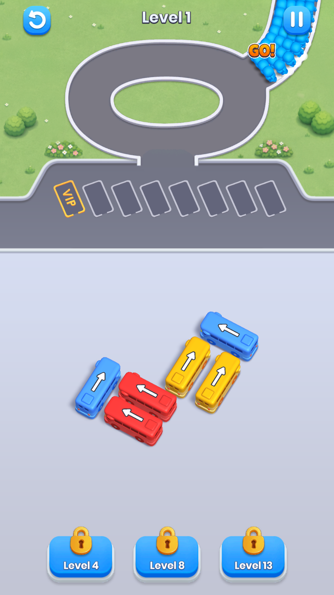

# Gameplay và onboarding

## Bằng chứng runtime

Ảnh `R003` chụp giai đoạn đầu Level 1 trước khi toàn bộ tutorial/khách hiện ổn định. `R004–R010` ghi tutorial và thao tác; `R011` là Victory. Tên file `blocked-test` là tên ca thử, không tự xác nhận input bị chặn bởi collision: lúc đầu tutorial cũng đang khóa mục tiêu.

## Core loop đã quan sát

1. Khách nhiều màu chạy theo tuyến vòng phía trên; nhóm khách mới nối vào từ nhánh đường ngoài màn hình.
2. Người chơi tap xe trong bãi phía dưới. Xe có mũi tên chỉ hướng đi và phải có lối thoát phù hợp.
3. Xe rời layout, đi theo đường cong vào một ô đỗ phía trên. Có trail khói trắng và nhịp thay đổi hướng.
4. Khách cùng màu tách khỏi tuyến chính, đi về xe. Số cạnh xe giảm trong lúc đón khách; không phải chỉ số sức chứa cố định luôn giữ nguyên.
5. Xe hoàn tất đón khách rời ô, có khói/confetti. Ô đỗ được giải phóng cho xe khác.
6. Khi giải hết màn, xuất hiện Victory, reward và Next.

Không suy luật chọn nhóm khách, thứ tự ưu tiên giữa hai xe cùng màu hoặc thuật toán đường đi chỉ từ ảnh. Các ca kiểm chứng này vẫn còn mở.

## UI trên viewport 1080 × 1920

| Element | Vị trí quan sát gần đúng | Trạng thái/hành vi |
| --- | --- | --- |
| Replay | Trái trên, tâm khoảng (120, 65) | Icon mũi tên quay lại, nền xanh bo tròn |
| Level label | Giữa trên, tâm khoảng (540, 55) | Chữ trắng, viền tối |
| Pause | Phải trên, tâm khoảng (960, 65) | Mở popup Settings |
| Passenger loop | Khoảng y=0–530 | Model 3D nhiều màu, bóng, chuyển động theo tuyến |
| Parking | Khoảng y=560–750 | Ô thường viền xám; VIP viền vàng; ô thêm có dấu cộng xanh |
| Board | Khoảng y=830–1610, thay đổi theo layout | Model xe 3D; không thay bằng sprite screenshot |
| Boosters | Dưới cùng, tâm x≈260/540/820 | Locked, free tutorial, count badge, các trạng thái khác |

Các tọa độ trên là đo bằng mắt để định vị, không phải rect nghiệm thu. Anchor, pivot, sizeDelta và component fields lấy tại [GamePanel](GamePanel/structure.md); [CSV](GamePanel/ui-elements.csv) giữ source path ID và media binding.

## Onboarding đã đi qua

- Lần vào game chơi được đưa trực tiếp vào Level 1; chưa thấy Home trước level đầu trong phiên này.
- Tutorial có bàn tay trắng lặp chuyển động, viền vàng trên xe được hướng dẫn và card kem chữ nâu: “Tap the vehicle to match the passengers”.
- Target được đổi theo tiến độ, các tap không hợp mục tiêu trong tutorial chưa đủ để kiểm tra collision thực tế.
- Level 1 có 7 ô thường và 1 VIP. Level 2 trở đi trong mẫu quan sát chỉ có 4 ô thường mở và 3 dấu cộng; không hardcode 7 ô cho mọi màn.
- Booster dưới cùng khóa ở Level 4, 8, 13. Level 4 đã mở VIP bằng popup riêng.

## Các trường hợp đã thử

| Case | Quan sát | Evidence |
| --- | --- | --- |
| Level 1 full loop | Chọn các xe theo tutorial, hoàn tất và hiện reward 20 | R004–R011 |
| Level 2 restart | Settings → Restart → transition → cùng layout Level 2 | R016–R019 |
| Nhiều xe vào ô | Có số đếm khác nhau cạnh các xe cùng màu đang đón khách | R021–R027 |
| Không có chỗ | Toast “No spots available”, xe cần đưa ra vẫn ở bãi; chưa phải bằng chứng thua ngay | R023, R026 |
| Level 3 | Có xe nhỏ/xe dài và hai nhánh khách vào tuyến trên | R031–R044 |

## Còn phải kiểm chứng

Luật fail/jam đầy đủ; save mid-level; thứ tự ưu tiên cùng màu; collision ở mọi hướng; spam input trong chuyển động; xử lý khi khách tới cuối vòng; camera/layout ở aspect khác; level mới và các cơ chế đặc biệt. Giữ riêng các cơ chế chỉ thấy trong metadata/config: ambulance, firetruck, linkage, wrench, elevator, garage, turn, police, luxury, combination, gate queue, traffic light và limit count.
