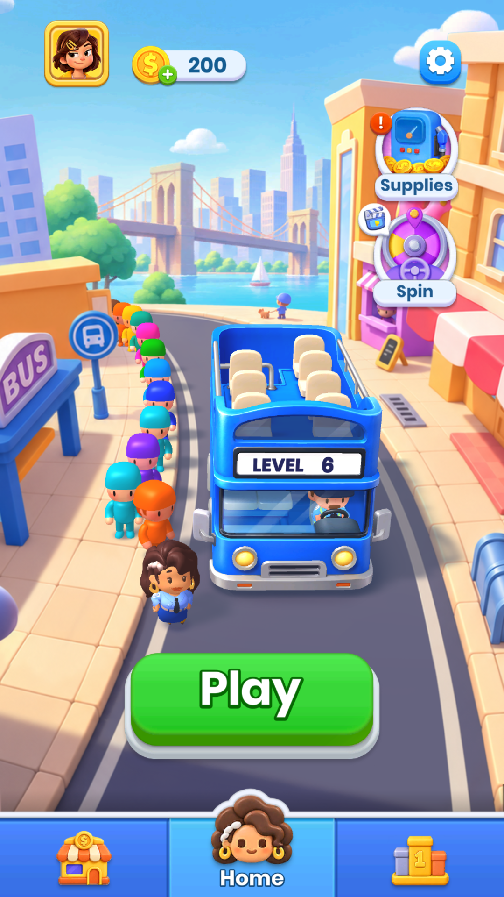
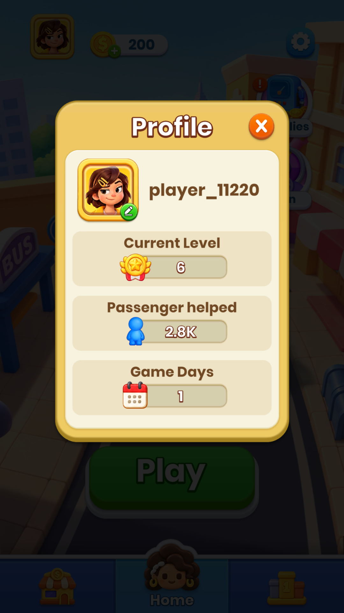
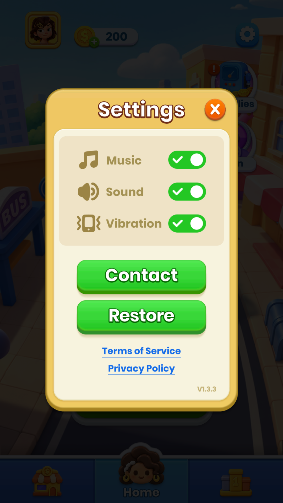

# Home, navigation và Profile

## Home tại progression Level 6

Home đã được quan sát ở trạng thái Level 6. Không kết luận chính xác mở sau level nào: chuỗi capture không ghi liền toàn bộ chuyển tiếp Level 4–6.

Thành phần: avatar góc trái, coin pill và dấu cộng, Settings góc phải; Supplies và Spin ở cạnh phải; cảnh phố/cầu/nước phía xa, xe bus 3D giữa đường, hàng khách bên trái, nhân vật hướng dẫn phía trước, nút Play xanh và navigation dưới cùng Shop/Home/Leaderboard. Biển trước bus ghi level sắp chơi. Đây là cảnh có animation và model, không phải một ảnh nền UI duy nhất.

Bottom navigation có trạng thái selected lớn/nổi hơn. Shop và Leaderboard thay vùng nội dung, giữ navigation. Home có các node task bar trong prefab nhưng chưa hiển thị task bar ở state chụp này: không bật mọi child có trong prefab lên cùng lúc.

Nguồn: [HomePanel](HomePanel/structure.md), [component CSV](HomePanel/ui-elements.csv). Asset font phổ biến được resolve là `Poppins-Bold SDF`; mỗi node giữ font/material riêng trong dữ liệu, không suy toàn bộ game chỉ dùng một font.

## Profile

Tap avatar → Profile. Gồm avatar/pencil edit, nickname, Current Level, Passenger helped, Game Days và X. Mẫu ghi Level 6, 2.8K passenger, 1 day. Đó là snapshot account đang dùng, không phải số mặc định cho mọi người chơi.

Pencil → Edit Profile: avatar preview lớn, nickname với pencil riêng, grid 3×3 avatar, viền xanh/check cho lựa chọn, Save và X. Đã mở và đóng bằng X, chưa đổi nickname/avatar. Có 9 avatar đúng với số entry trong `UserProfileConfig`; max nickname 15 trong config vẫn cần thử validation runtime.

Nguồn: [UserProfilePanel](UserProfilePanel/structure.md), [UserProfileEditPanel](UserProfileEditPanel/structure.md). Còn mở: chọn/cancel có rollback, save persistence, empty/bad nickname, keyboard/safe area và cloud identity.

## Settings tại Home

Ngoài 3 toggle Music/Sound/Vibration, có Contact, Restore, Terms of Service, Privacy Policy và version V1.3.3. Tap Restore trong mẫu trả toast “Nothing to restore” (R068). Chưa thử mua rồi restore; kết quả này không chứng minh restore entitlement đã hoạt động với account có purchase.

Không gửi email Contact hoặc tác động account bên ngoài trong audit. [SettingPanel](SettingPanel/structure.md) là prefab riêng với PausePanel của gameplay.
