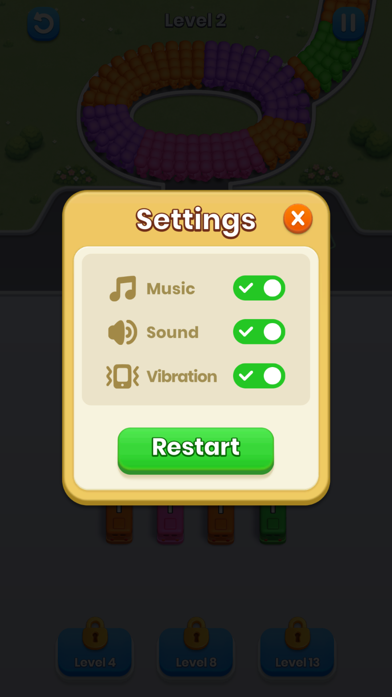

# Settings, Restart và interruption

## UI và flow đã quan sát

Tap Pause ở góc phải → overlay tối toàn màn hình → card vàng/kem ở giữa. Card có tiêu đề Settings, nút đóng X màu cam, Music/Sound/Vibration và Restart xanh. Trong các ảnh đã chụp ở Level 2 và 4 không có nút Home.

Ở viewport 1080×1920, card gần đúng x=170–910, y=525–1390; tâm toggle x≈715, ba hàng y≈795/915/1035. Đây là vùng đo bằng mắt. Bảng serialized chính xác: [PausePanel](PausePanel/structure.md), [UI CSV](PausePanel/ui-elements.csv). Không dùng SettingPanel ở Home thay cho PausePanel trong gameplay.

| Thao tác | Kết quả | Evidence |
| --- | --- | --- |
| Tap Music | Toggle xanh/check sang màu nâu/X, núm sang trái | R016 → R017 |
| Restart Level 2 | Vào chuyển cảnh nền trời/mây/máy bay, trở lại Level 2 | R018–R019 |
| Mở lại Settings ở Level 4 | Music vẫn OFF qua các level | R051 |
| Android Back trong gameplay | Không hiện popup mới ở lần thử này | R052 |

Music đã được bật lại sau ca thử. Chưa xác nhận chức năng Sound/Vibration bằng nghe/rung thiết bị thật; hình trạng thái toggle không chứng minh mixer/haptic đang hoạt động.

## Pause semantics chưa kết luận

Các ảnh nền trước/sau có vị trí khách khác nhau, nhưng không đủ xác định simulation vẫn chạy hay chỉ tween trang trí chạy trong pause. Cần xem timeline liền mạch hoặc đo cùng đối tượng khi popup mở. Metadata có `OnPaused`/`OnResume`, không dùng tên method để kết luận timeScale.

## Interruption

Sau luồng quảng cáo, app được mở lại và vào Level 4 với layout được dựng lại, VIP count còn 1. Chưa xác định nguyên nhân app rời phiên là ad SDK, thao tác ngoài phiên hay lifecycle khác; không kết luận crash hoặc save bug. Mid-level board persistence và thưởng quảng cáo phải kiểm chứng bằng ca riêng có video/log liên tục.
