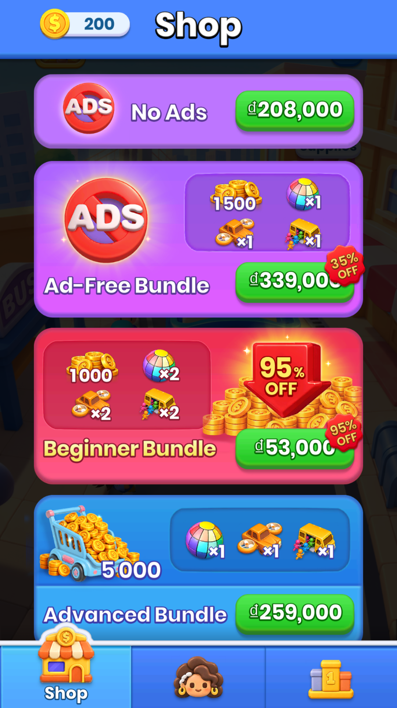
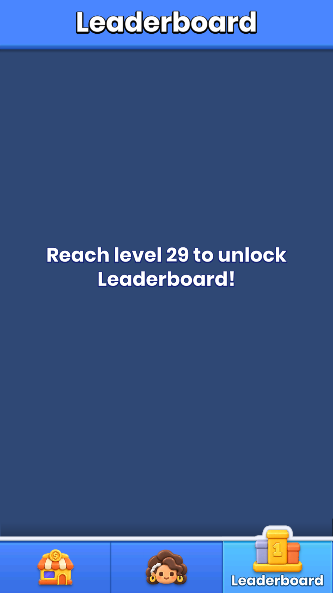

# Shop và trạng thái khóa Leaderboard

## Shop

Đã vào từ tab trái dưới và scroll tới cuối. Header xanh với coin balance bên trái, chữ Shop ở giữa; các offer card nằm trong scroll view, navigation cố định ở đáy. Có card No Ads/Ad-Free màu tím, Beginner đỏ/hồng, các bundle xanh và grid coin pack. Button giá xanh, typography trắng viền tối; badge giảm giá đỏ/vàng.

Giá dưới đây là **giá được hiển thị tại phiên audit**, locale/store account hiện tại. Không phải giá cố định trong gameplay config hoặc bằng chứng một giao dịch đã hoàn tất.

| Offer | Nội dung/giá đã nhìn thấy |
| --- | --- |
| No Ads | đ208,000 |
| Ad-Free Bundle | 1.500 coin + 1 mỗi booster, đ339,000, badge 35% OFF |
| Beginner Bundle | 1.000 coin + 2 mỗi booster, đ53,000, badge 95% OFF |
| Advanced Bundle | 5.000 coin + 1 mỗi booster, đ259,000 |
| Expert Bundle | Header/giá đ521,000 được thấy khi scroll; xem R070/R071 để đối chiếu nội dung |
| Ultimate Bundle | 25.000 coin + 4 mỗi booster, đ834,000 |
| 1.000 / 5.000 / 10.000 coin | đ53,000 / đ206,000 / đ392,000 |
| 25.000 / 50.000 / 100.000 coin | đ860,000 / đ1,550,000 / đ2,600,000 |

Evidence: R069–R072. Chưa tap xác nhận mua, chưa tạo giao dịch thật. Chưa kiểm tra purchase pending/cancel/error/restore có entitlement. Loading/failed/restore prefab được giữ trong static catalog để audit tiếp.

Nguồn: [ShopPanel](ShopPanel/structure.md). Các offer item có prefab riêng; không thể tái dựng toàn bộ Shop chỉ từ 9 component trên root ShopPanel. Root chứa scroller, các item được tạo/bind động.

## Leaderboard locked

Tap tab phải khi đang Level 6 → header Leaderboard, nền xanh và thông báo “Reach level 29 to unlock Leaderboard!”. Đây là trạng thái runtime đã xác nhận, khớp giá trị 29 trong RankingConfig. Chưa có bằng chứng bảng xếp hạng thực, rank-up, weekly reward, reset hay global refresh.

Không dùng danh sách bot tier trong config để gọi leaderboard đang thấy là người chơi online hoặc để kết luận toàn bộ leaderboard là giả. Cần kiểm tra từng chế độ tại runtime sau khi mở.
