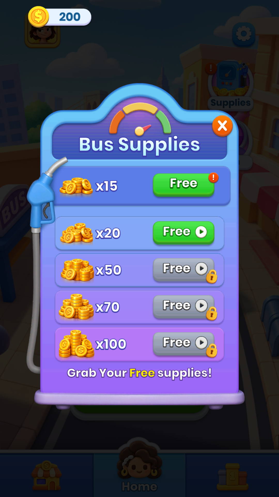
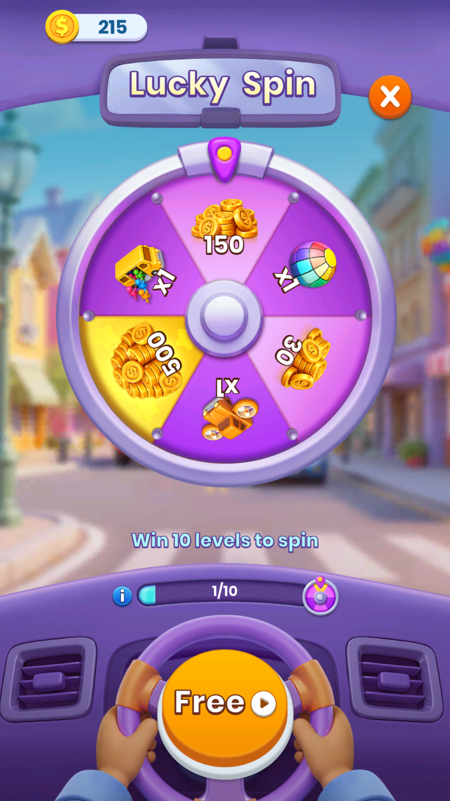

# Supplies và Lucky Spin

## Supplies

Home → Supplies mở card kiểu trạm xăng, nền xanh/tím, icon đồng hồ nhiên liệu, vòi xăng bên trái, X cam phía trên. Các hàng coin nhìn thấy: 15, 20, 50, 70, 100. Hàng 15 có Free không icon ad; 20 có Free/play; 50/70/100 có play và lock trong mẫu đầu tiên.

Đã claim hàng 15: coin từ 200 tăng dần (R075 đang ở 214) và ổn định 215 khi vào Spin (R076). Button đổi sang countdown `59m58s`. Điều này xác nhận một lượt grant +15 và trạng thái cooldown khoảng một giờ trong mẫu; chưa xác nhận tính timer qua đổi giờ, offline/relaunch hoặc ngày mới. Không tự sửa đồng hồ để thử.

Chưa xem ad cho các hàng sau, chưa xác nhận điều kiện mở 50/70/100. Nguồn: [SuppliesPanel](SuppliesPanel/structure.md).

## Lucky Spin

Home → Spin mở màn riêng chủ đề khoang lái: coin pill trái trên, biển Lucky Spin, X cam, wheel 6 phần và pointer cố định phía trên; progress “Win 10 levels to spin” và 1/10 tại lần chụp; nút Free có play trên vô lăng, có bàn tay nhân vật.

Tap i cạnh progress mở popup `Prob.` với các giá trị UI:

| Reward | Xác suất hiển thị |
| --- | --- |
| 500 coin | 1.00% |
| Jumble icon ×1 | 8.00% |
| VIP icon ×1 | 8.00% |
| Arrange icon ×1 | 8.00% |
| 30 coin | 25.00% |
| 150 coin | 50.00% |

Evidence: R077. Tên booster ở đây đối chiếu icon/config; tỷ lệ là nội dung màn thông tin, chưa phải kiểm nghiệm phân phối RNG. Không suy diện tích lát wheel tỷ lệ với xác suất. Chưa quay nhận reward, chưa đo gia tốc/giảm tốc, rigging pointer hay behavior khi thoát giữa spin.

Nguồn root được xuất tên `DailySpin`; [cấu trúc prefab](DailySpin/structure.md) giữ panel và các component con. Một prefab chứa nhiều vùng UI không nhất thiết tương ứng một màn runtime.
