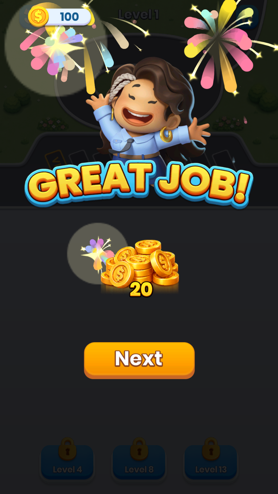

# Victory và coin reward

## Thành phần

- Overlay tối phủ gameplay; bãi và level label vẫn nhìn thấy phía sau.
- Coin balance pill ở góc trái trên; Level 1 chụp thấy 100 trước claim.
- Nhân vật ăn mừng, hai tay mở rộng; typography “GREAT JOB!” màu vàng/cam viền xanh và tối.
- Firework/confetti nhiều màu, tia trắng và ánh sáng tròn.
- Hình chồng coin với số reward 20.
- Nút Next lớn màu vàng/cam phía dưới.

Balance được quan sát thành 160 tại Level 4 sau ba level đầu, phù hợp ba lần +20 từ 100; cần video giao dịch để xác định chính xác thời điểm ghi save. Không suy rằng mọi level đều thưởng 20.

## Motion và trạng thái

Có pha vào, pha giữ và pha ra riêng. Trong export, `Effect_VictoryPanel_In` dài 2.8 giây ở sample rate 60; đây là độ dài clip serialized, chưa phải delay khóa input thực tế. Nhân vật còn dùng Spine (`victory_SkeletonData`), nên không chỉ sao chép một AnimationClip là đủ.

Next đi tới level tiếp theo qua transition. Một ảnh sau tap có thể vẫn hiển thị level cũ/board trống trong chuyển cảnh; không dùng ảnh đó để xác nhận màn đã ổn định.

Nguồn UI: [VictoryPanel](VictoryPanel/structure.md), [components](VictoryPanel/ui-elements.csv). Cần kiểm tra thêm reward x2/ad, hard/superhard, task bar collect và skip khi các điều kiện đó mở.
