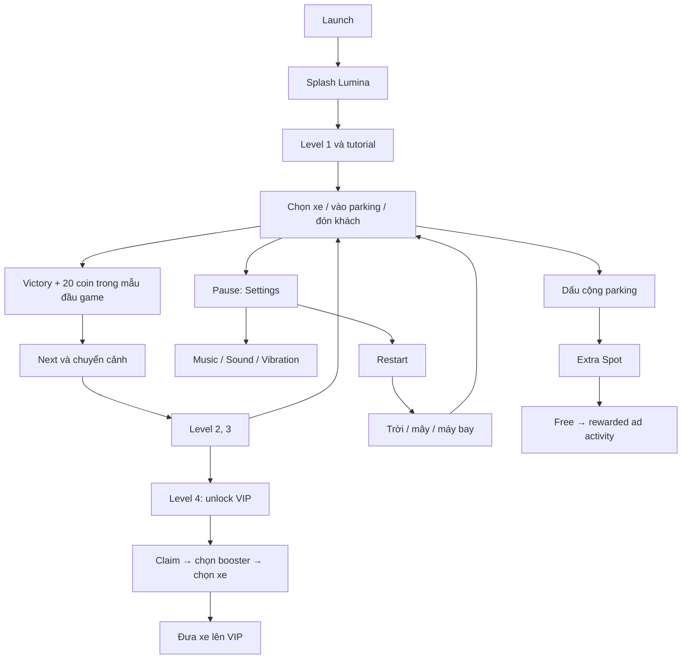
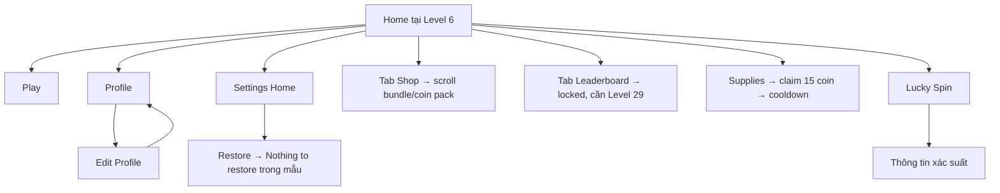

# Flow và coverage

## Flow đã quan sát

Mũi tên Rewarded ad → cấp slot chưa xác minh. Các nhánh fail/revive chưa được quan sát. Home đã thấy tại progression Level 6, nhưng thiếu capture liền mạch để xác định mốc mở chính xác.

## Module chỉ có bằng chứng tĩnh hoặc coverage chưa đủ

| Module | Bằng chứng đọc được | Cần làm tiếp |
| --- | --- | --- |
| Home/navigation | Đã quan sát Home Level 6 và 3 tab | Xác định chính xác mốc mở; entry khi returning và mọi entrance |
| Shop/IAP/ad-free | Đã mở/scroll Shop, ghi giá; Restore trả Nothing to restore | Purchase pending/cancel/error và restore entitlement chưa kiểm chứng |
| Life/supplies | Bundle và UI/config candidates | Xác định điều kiện mất/refill và timer |
| Daily bonus | Bundle/module/panel | Entry, lịch ngày, claim và reset |
| Spin | Đã mở Lucky Spin, progress và popup Prob. | Quay thực tế, reward, cooldown và kiểm nghiệm RNG |
| Ranking | Đã thấy thông báo reach level 29; config có bot tier/weekly count | Mở leaderboard thực, refresh, weekly reward |
| User profile | Đã mở Profile/Edit và đóng; 9 avatar | Invalid/confirm/save persistence |
| Task bar | Nhiều panel, TemplateConfigs/CollectionConfigs | Unlock, mục tiêu, reward, reset/expire |
| Color Guess | Panel/config/rounds | Entry, rule, streak, reward và timer |
| Cloud save | Config trong bundle có Enable=0 | Xác minh remote override; không suy toàn game không hỗ trợ cloud |
| Fail/Revive | Replay/Revive/Fail prefab và methods | Tạo fail theo luật bình thường, thử từng reason và exit |
| Mechanisms nâng cao | Guide types và config cho nhiều họ cơ chế | Mở level tương ứng, quay từng interaction |
| Toàn bộ level | Manifest address có level bundle AES | Chưa decode layout/sequence, chưa chơi hết |

Các file `features/<PrefabName>/structure.md` là hồ sơ **serialized UI** cho 73 prefab, không phải bằng chứng đã bấm qua 70 màn. Bảng component có toàn bộ fields để điều tra tiếp; narrative runtime phải bổ sung cho từng feature khi mở được.
